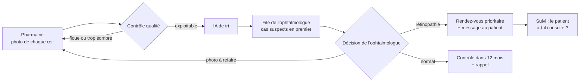

# Basira

**Dépistage de la rétinopathie diabétique, là où les diabétiques vont déjà.**

Basira permet de photographier le fond d'œil d'un patient diabétique en pharmacie, de vérifier tout de suite que la photo est exploitable, de trier les examens avec une IA, puis de les faire lire à distance par un ophtalmologue partenaire. Le patient à risque reçoit un rendez-vous ; les autres reçoivent un rappel un an plus tard.

> ⚠️ Prototype de recherche (v0.1). Ce logiciel **n'est pas un dispositif médical** et ne doit pas être utilisé pour poser un diagnostic. Aucune donnée de patient réel n'est utilisée dans ce dépôt.

Projet incubé à **Spark by ECC** (École Centrale Casablanca), 2026-2027.

---

## Le problème

- Au Maroc, **2,7 millions d'adultes** sont diabétiques, soit environ un adulte sur dix (ministère de la Santé, novembre 2025).
- La rétinopathie diabétique est l'une des principales causes de cécité chez les adultes en âge de travailler. Elle ne fait pas mal : quand la vue baisse, il est souvent trop tard.
- Un examen annuel du fond d'œil suffit à la détecter tôt, mais il est peu pratiqué. Lors d'un dépistage à Fès (430 patients suivis dans un centre spécialisé, 2012-2013), **44,6 %** avaient une rétinopathie et **38,8 %** n'avaient jamais vu d'ophtalmologiste. Après le dépistage, **69 %** des patients atteints sont allés consulter.

## La solution



L'IA ne pose pas de diagnostic : elle ordonne la file de lecture. **C'est l'ophtalmologue qui décide.**

## État du projet (v0.1)

| Brique | État | Détail |
|---|---|---|
| API (FastAPI) | ✅ Fait | Dépistage, file de l'ophtalmologue, décision, messages, statistiques |
| Contrôle qualité des photos | ✅ Fait | Netteté (laplacien), luminosité, taille du champ. Seuils à calibrer sur de vraies photos |
| Prétraitement des images | ✅ Fait | Recadrage, mise au carré, normalisation de Ben Graham, masque circulaire |
| Tri des examens | ✅ Fait | Un œil suspect suffit pour rendre l'examen prioritaire |
| Pipeline d'entraînement de l'IA | ✅ Fait, testé sur données synthétiques | Format APTOS 2019, EfficientNet-B0 ou ResNet-18, seuil choisi pour une sensibilité cible |
| Modèle entraîné sur de vraies images | ⏳ v0.2 | Entraînement sur APTOS 2019, puis validation sur des photos marocaines |
| Messages au patient | 🟡 Générés, pas envoyés | Branchement SMS / WhatsApp prévu en v0.3 |
| Application tablette pour la pharmacie | 🟡 Maquette | Voir `demo/maquette.html` |
| Stockage sécurisé des données de santé | ⏳ À faire | Chiffrement, contrôle d'accès, déclaration CNDP (loi 09-08) |

## Structure du dépôt

```
basira/
├── basira/
│   ├── api.py            # API FastAPI : le parcours complet
│   ├── server.py         # point d'entrée (uvicorn basira.server:app)
│   ├── quality.py        # contrôle qualité des photos
│   ├── preprocessing.py  # prétraitement avant l'IA
│   ├── triage.py         # règles de tri des examens
│   ├── messages.py       # messages au patient
│   ├── storage.py        # base SQLite
│   ├── classifier.py     # interface avec le modèle d'IA
│   ├── synthetic.py      # images synthétiques pour les tests
│   └── ml/
│       ├── dataset.py    # jeu de données au format APTOS
│       ├── model.py      # réseau de neurones
│       ├── train.py      # entraînement
│       ├── metrics.py    # sensibilité, spécificité, AUC
│       └── inference.py  # utilisation du modèle par l'API
├── scripts/              # jeux de données et images de démonstration
├── tests/                # tests automatiques (pytest)
└── demo/maquette.html    # maquette cliquable du parcours (sans serveur)
```

## Démarrer

Python 3.10 ou plus récent.

```bash
git clone https://github.com/<votre-compte>/basira.git
cd basira
python -m venv .venv
source .venv/bin/activate          # Windows : .venv\Scripts\activate
pip install -r requirements.txt -r requirements-dev.txt

pytest -q                          # lance les tests
uvicorn basira.server:app --reload # lance l'API
```

Ouvrez ensuite **http://127.0.0.1:8000/docs** : la documentation interactive permet d'essayer chaque étape depuis le navigateur.

### Essayer avec des images de démonstration

```bash
python -m scripts.make_demo_images   # crée data/demo/*.png (dessins, pas de vrais patients)

curl -X POST http://127.0.0.1:8000/screenings \
  -F initiales=M.B. -F age=61 -F duree_diabete=9 -F type_diabete=2 \
  -F telephone=0600000000 -F consentement=true \
  -F photo_od=@data/demo/od_lesions.png -F photo_og=@data/demo/og_saine.png

curl http://127.0.0.1:8000/queue
curl -X POST http://127.0.0.1:8000/screenings/BAS-0001/decision \
  -H "Content-Type: application/json" -d '{"decision": "rdv", "note": "microanévrismes OD"}'
curl http://127.0.0.1:8000/messages
curl http://127.0.0.1:8000/stats
```

Envoyer `data/demo/og_floue.png` renvoie une erreur 422 : le contrôle qualité demande de reprendre la photo.

### Principales routes

| Méthode | Route | Rôle |
|---|---|---|
| `POST` | `/screenings` | La pharmacie envoie les deux photos et les informations du patient |
| `GET` | `/queue` | File de l'ophtalmologue, cas suspects en premier |
| `GET` | `/screenings/{id}/photos/{od,og}` | Photo d'un œil |
| `POST` | `/screenings/{id}/decision` | Décision : `rdv`, `normal` ou `refaire` |
| `GET` | `/messages` | Messages à envoyer aux patients |
| `POST` | `/screenings/{id}/vu` | Le patient orienté a-t-il vu l'ophtalmologue ? |
| `GET` | `/stats` | Indicateurs, dont le taux de suivi (repère : 69 % à Fès) |

## Entraîner l'IA

```bash
pip install -r requirements-ml.txt
```

**Tester le pipeline sans données de santé** (quelques minutes sur un ordinateur portable) :

```bash
python -m scripts.make_synthetic_dataset --out data/synthetic --n 40
python -m basira.ml.train --csv data/synthetic/train.csv --images data/synthetic/train_images \
  --out models/essai.pt --arch resnet18 --no-pretrained --epochs 2 --img-size 128
```

Ce modèle-là n'apprend rien de médical : il vérifie seulement que le code fonctionne.

**Entraîner sur de vraies images** : télécharger le jeu public [APTOS 2019 Blindness Detection](https://www.kaggle.com/c/aptos2019-blindness-detection) sur Kaggle (compte gratuit), puis :

```bash
python -m basira.ml.train --csv data/aptos/train.csv --images data/aptos/train_images \
  --out models/basira-v0.pt --epochs 10
```

Un GPU est fortement conseillé (Google Colab suffit). Le script choisit le seuil de décision qui atteint 90 % de sensibilité sur la validation et enregistre les métriques dans `models/basira-v0.json`.

**Utiliser le modèle dans l'API** :

```bash
BASIRA_MODEL=models/basira-v0.pt uvicorn basira.server:app
```

## Limites

- **Pas un dispositif médical.** Pour de vrais patients, il faudra une IA certifiée (marquage CE ou équivalent) ou une validation clinique, et l'enregistrement du dispositif au Maroc.
- **Les seuils de qualité sont provisoires** : ils ont été réglés sur des images synthétiques et doivent être recalibrés sur des photos du rétinographe portable choisi.
- **Population** : APTOS 2019 vient d'Inde. Le modèle devra être validé sur des patients marocains avant tout usage.
- **Données de santé** : le stockage actuel (SQLite, photos sur disque) convient à un prototype uniquement.
- **Cadre légal à vérifier** : qui peut prendre la photo en pharmacie, et l'organisation de la télé-expertise (loi 131-13, décret 2-18-378).

## Feuille de route (Spark by ECC)

- **v0.1 (octobre 2026)** : API, contrôle qualité, tri, pipeline d'entraînement, tests.
- **v0.2 (janvier-février 2027)** : modèle entraîné sur APTOS 2019, mesure de la sensibilité et de la spécificité.
- **v0.3 (mars-avril 2027)** : application tablette pour la pharmacie, interface web de l'ophtalmologue, messages SMS / WhatsApp.
- **v0.4 (mai-juin 2027)** : essai avec une vraie caméra et un ophtalmologue partenaire, démonstration au Demo Day.

En parallèle : entretiens avec des pharmaciens, des ophtalmologues et des patients, et vérification du cadre légal.

## Sources

- Ministère de la Santé et de la Protection sociale, Journée mondiale du diabète, novembre 2025 ([Hespress](https://en.hespress.com/125554-diabetes-affects-2-7-million-adults-in-morocco-as-treatment-costs-top-1-5-billion-dirhams-health-ministry-says.html)).
- Dépistage de la rétinopathie diabétique par un rétinographe non mydriatique dans la région de Fès, *Journal Français d'Ophtalmologie* ([résumé](https://www.em-consulte.com/article/1027116/depistage-de-la-retinopathie-diabetique-par-un-ret)).
- Hammoudi et al., *Diabetic retinopathy in the Eastern Morocco* ([PMC](https://pmc.ncbi.nlm.nih.gov/articles/PMC7783821/)).
- APTOS 2019 Blindness Detection ([Kaggle](https://www.kaggle.com/c/aptos2019-blindness-detection)).

## Auteure

**Aya Frik**, École Centrale Casablanca. Code initial écrit avec l'assistance de Claude (Anthropic).

## Licence

MIT, voir [LICENSE](LICENSE).
